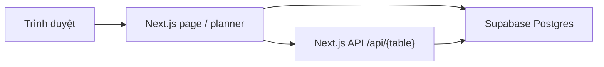
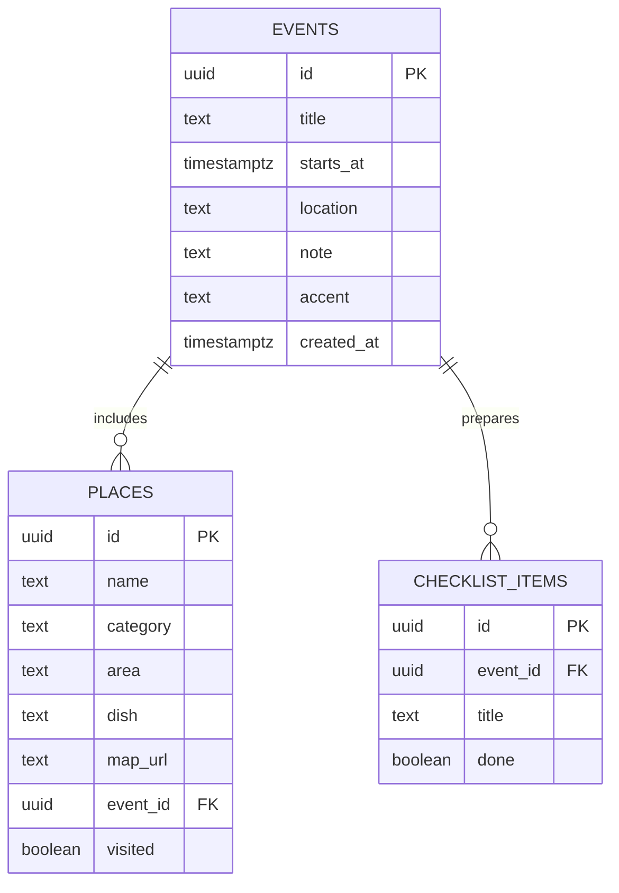

# Kiến trúc ứng dụng

## Tổng quan

Ứng dụng dùng Next.js App Router làm web server và API CRUD, Supabase Postgres làm nơi lưu dữ liệu. Không có đăng nhập trong MVP; các route cho phép bảng cố định để tránh người gọi API tùy ý truy cập bảng khác.

Trang server tải dữ liệu ban đầu qua Supabase và truyền một snapshot thời gian để lần render đầu của Client Component khớp với HTML SSR. Các ngày giờ hiển thị và nhập được chuẩn hóa theo múi giờ `Asia/Ho_Chi_Minh`; database lưu instant dưới dạng `timestamptz`. Client component `Planner` quản lý state tương tác. Mỗi thao tác ghi gọi Next.js route handler, route kiểm tra tên bảng trong allowlist rồi gọi Supabase bằng anon key; RLS quyết định quyền thao tác.

## Các thành phần

- `app/page.tsx`: tải dữ liệu; trả danh sách rỗng cùng lỗi nếu Supabase không truy cập được.
- `app/planner.tsx`: countdown, điều hướng, form và state CRUD.
- `app/api/[table]/route.ts`: POST/PATCH/DELETE; chỉ chấp nhận `events`, `places`, `checklist_items`.
- `lib/supabase.ts`: tạo client server-side từ URL và anon key.
- `lib/data.ts`: đọc ba bảng hoặc trả demo nếu thiếu env.
- `lib/types.ts`: kiểu dữ liệu giao diện.
- `supabase/schema.sql`: schema, foreign keys, index và policies.

## Mô hình dữ liệu

Khi xóa sự kiện, checklist liên quan bị xóa (`ON DELETE CASCADE`); địa điểm vẫn còn và `event_id` thành null (`ON DELETE SET NULL`).

## API

| Method | Path | Nội dung |
|---|---|---|
| POST | `/api/events` | Tạo sự kiện |
| PATCH | `/api/events` | Cập nhật theo `id` |
| DELETE | `/api/events?id=...` | Xóa sự kiện |
| POST/PATCH/DELETE | `/api/places` | CRUD địa điểm |
| POST/PATCH/DELETE | `/api/checklist_items` | CRUD checklist |

API trả JSON cho kết quả/error; DELETE thành công trả 204. Không có pagination trong MVP.

## State và lỗi

- Server tải dữ liệu lúc render; thao tác CRUD cập nhật client state theo phản hồi API.
- Checklist cập nhật lạc quan và hoàn tác khi request thất bại.
- Lỗi Supabase khi tải hiển thị ở đầu trang; lỗi thao tác hiển thị toast.
- Dữ liệu demo dùng ID giả định danh `demo-*`; không ghi đè dữ liệu Supabase.

## Mở rộng dự kiến

1. Bổ sung auth, bảng không gian chung/membership và `owner_id` hoặc `space_id`.
2. Thay public RLS policies bằng policy xác thực theo membership.
3. Thêm validation schema phía server, giới hạn độ dài, URL validation và rate limit.
4. Thêm ảnh, trạng thái đã ghé, tìm kiếm/lọc và nhắc lịch theo nhu cầu.
