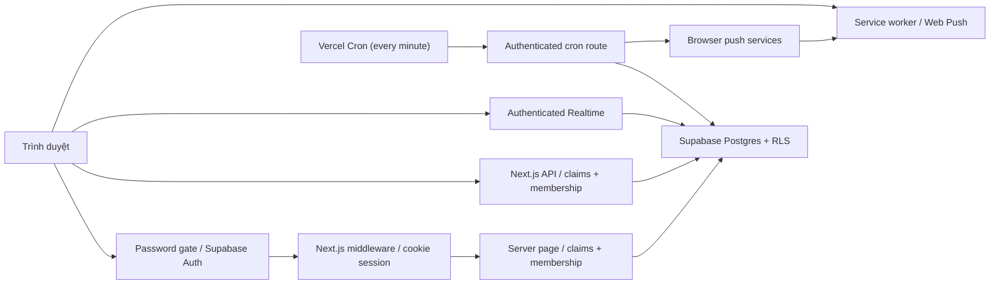
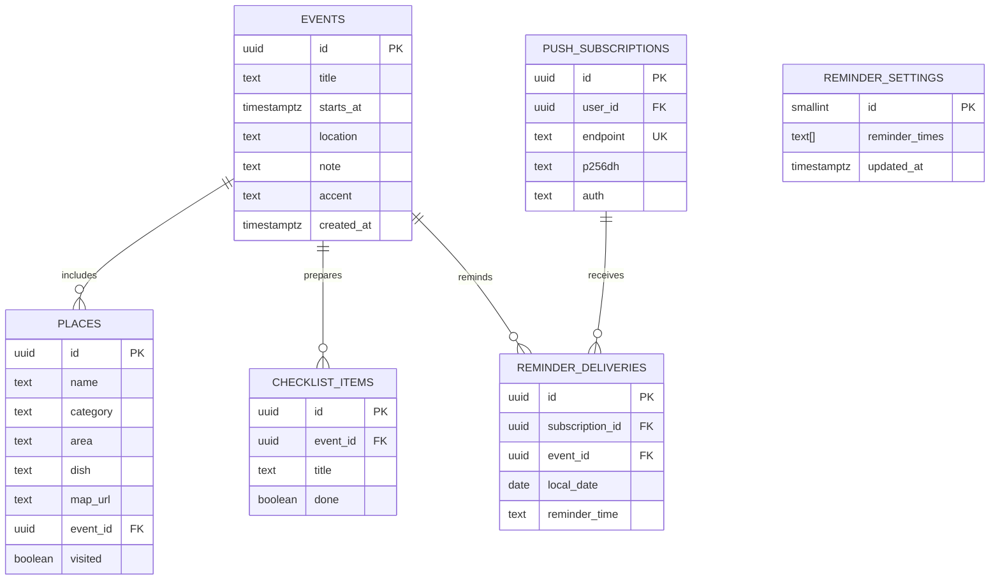

# Kiến trúc ứng dụng

## Tổng quan

Ứng dụng dùng Next.js App Router làm web server/API, Supabase Auth để xác thực và Supabase Postgres làm nơi lưu dữ liệu. Một Auth account dùng chung trên các thiết bị; `planner_members` là danh sách user được quyền vào planner.

Middleware làm mới cookie session. Trước khi tải dữ liệu planner, server xác minh JWT bằng `getClaims()` và kiểm tra membership; khách chưa được cấp quyền chỉ nhận màn hình khóa. API lặp lại kiểm tra này cho mọi thao tác, còn RLS kiểm tra lần cuối ngay trong database. Browser dùng anon key cùng user JWT cho CRUD theo session và subscription realtime; không dùng `service_role`. Thời điểm SSR được gửi xuống để lần render đầu khớp HTML; ngày giờ dùng múi giờ `Asia/Ho_Chi_Minh` và database lưu `timestamptz`.

## Các thành phần

- `app/page.tsx`: xác minh session/membership trước khi tải dữ liệu; trả gate nếu chưa có quyền.
- `app/components/AccessGate.tsx`: form đăng nhập Auth bằng email cố định cấu hình, không hiển thị email.
- `middleware.ts`, `lib/supabase/{server,client,middleware}.ts`: clients và cookie session SSR.
- `lib/planner-auth.ts`: kiểm tra claims và membership dùng chung cho page/API.
- `app/planner.tsx`: điều phối state CRUD, điều hướng và form; các hàng sự kiện, món/quán và checklist tách thành component trong `app/components/`.
- `app/hooks/usePlannerRealtime.ts`: đăng ký Postgres Changes cho ba bảng planner; `ReminderSettings` đăng ký riêng bảng `reminder_settings`. Các listener cập nhật giao diện theo thay đổi và tải lại snapshot khi cần.
- `app/components/HeroCard.tsx`: quản lý nhịp cập nhật countdown riêng mỗi giây để không render lại toàn trang theo đồng hồ.
- `app/components/EventRow.tsx`, `PlaceRow.tsx`, `ChecklistRow.tsx`: render từng hàng và nhận callback thao tác từ Planner.
- `lib/dates.ts`: timezone ứng dụng, chuyển đổi input datetime-local và định dạng SSR/client thống nhất.
- `app/api/[table]/route.ts`: POST/PATCH/DELETE; chỉ chấp nhận `events`, `places`, `checklist_items`.
- `app/components/ReminderSettings.tsx`: giờ nhắc toàn cục, đồng bộ Realtime và đăng ký/tắt push riêng trên thiết bị.
- `app/components/PwaUpdatePrompt.tsx`: đăng ký service worker ngay cả trước đăng nhập, kiểm tra phiên bản mới khi mở app/foreground và định kỳ, cho người dùng chủ động kích hoạt rồi tải lại bản mới.
- `app/api/reminders/settings/route.ts`: đọc/cập nhật tối đa 8 giờ `HH:mm` bằng membership session và RLS.
- `app/api/reminders/subscriptions/route.ts`: lưu/xóa subscription theo endpoint qua phiên thành viên.
- `app/api/reminders/test/route.ts`: gửi push thử ngay tới subscription thuộc user hiện tại để tách lỗi thiết bị/VAPID khỏi lịch cron.
- `app/api/cron/reminders/route.ts`: kiểm tra bearer secret, đọc giờ + sự kiện qua service role, claim lượt gửi idempotent và gửi Web Push.
- `public/manifest.webmanifest`, `public/sw.js`, `public/icon.svg`, `public/icon-maskable.svg` và PNG: metadata PWA, biểu tượng cài đặt có vùng an toàn riêng và xử lý push/click; service worker chỉ cache manifest/icon. `assets/icons/apple-touch-icon.svg` là vector nguồn cho PNG iOS vuông nền đặc.
- `vercel.json`: khai báo Vercel Schedule gọi route nhắc lịch mỗi 15 phút để tương thích Hobby; route có cửa sổ bắt kịp 30 phút.
- `lib/supabase.ts`: URL/key Supabase và email đăng nhập lấy từ env.
- `lib/data.ts`: đọc dữ liệu qua client gắn với session người dùng.
- `lib/types.ts`: kiểu dữ liệu giao diện.
- `supabase/schema.sql`: schema, membership, foreign keys, index, RLS authenticated-only và publication realtime.

## Mô hình dữ liệu

Khi xóa sự kiện, checklist liên quan bị xóa (`ON DELETE CASCADE`); địa điểm vẫn còn và `event_id` thành null (`ON DELETE SET NULL`).

## API

| Method | Path | Nội dung |
|---|---|---|
| POST | `/api/events` | Tạo sự kiện |
| PATCH | `/api/events` | Cập nhật theo `id` |
| DELETE | `/api/events?id=...` | Xóa sự kiện |
| POST/PATCH/DELETE | `/api/places` | CRUD địa điểm |
| POST/PATCH/DELETE | `/api/checklist_items` | CRUD checklist |

API trả JSON cho kết quả/error; DELETE thành công trả 204. Không có pagination trong MVP.

## Push reminders

- Web client chỉ gửi public VAPID key; private key và `SUPABASE_SERVICE_ROLE_KEY` chỉ có ở môi trường server. User APIs xác thực session/membership và dùng RLS.
- Lịch là cấu hình toàn cục một hàng `reminder_settings`; subscription lưu riêng theo endpoint và user, để user API chỉ xem/xóa thiết bị của chính mình. Worker dùng service role để gửi đến mọi thiết bị đã đăng ký.
- Vercel Schedule gọi endpoint mỗi 15 phút; route chỉ nhận `Authorization: Bearer <CRON_SECRET>`. Bảng `reminder_deliveries` dùng unique key theo thiết bị/sự kiện/ngày local/giờ để tránh gửi lặp khi schedule chạy lại.
- Lượt nhắc chọn sự kiện tương lai gần nhất. Nếu không có sự kiện sắp tới thì không gửi. Delivery claim bị xóa nếu dịch vụ push trả lỗi để lần cron sau có thể thử lại.
- PWA shell không phải offline data cache; page/auth/CRUD vẫn cần mạng.

## State và lỗi

- Server tải dữ liệu lúc render; thao tác CRUD cập nhật client state theo phản hồi API.
- Checklist cập nhật lạc quan và hoàn tác khi request thất bại.
- Lỗi Supabase khi tải hiển thị ở đầu trang; lỗi thao tác hiển thị toast.
- Realtime dùng publication `supabase_realtime`; subscription cần JWT Auth và membership hợp lệ.
- Thiếu cấu hình Supabase, app chỉ hiển thị hướng dẫn kết nối và không trả dữ liệu demo.

## Phân trang và quy mô dữ liệu

Hiện ba bảng được tải cùng lúc vì đây là planner cá nhân dự kiến có ít bản ghi; chưa có phân trang server-side. Không nên chỉ cắt danh sách ở client vì như vậy vẫn tải toàn bộ dữ liệu và làm sai tiến độ checklist. Khi một bảng vượt khoảng 100 bản ghi hoặc thời gian/khối lượng tải SSR bắt đầu ảnh hưởng rõ, bổ sung cursor/range pagination ở Supabase và API, đồng thời giữ riêng truy vấn lịch tương lai, lịch cũ và checklist theo sự kiện. Chưa bật phân trang trong bản này vì dữ liệu hiện tại không có dấu hiệu vượt ngưỡng và cần giữ đầy đủ checklist/progress trong luồng hiện tại.

## Mở rộng dự kiến

1. Thêm validation schema phía server, giới hạn độ dài, URL validation và rate limit.
2. Nếu cần phân biệt người dùng, thay account dùng chung bằng user riêng và membership theo không gian.
3. Thêm ảnh và tìm kiếm/lọc khi quy mô dữ liệu hoặc nhu cầu sử dụng tăng.
